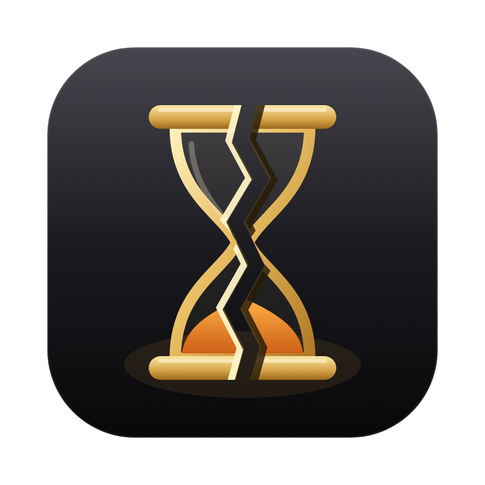

# Depleted.app

**A Mythic+ recorder for World of Warcraft on macOS.**

Automatically records your World of Warcraft **Mythic+ keys** on macOS, syncs the video with
the combat log, and puts the moments that matter on a timeline: boss kills, wipes, party
deaths, interrupts. Click a marker to jump straight to it.

The goal is a native-feeling macOS take on what [Warcraft Recorder](https://warcraftrecorder.com/)
does on Windows. It records Mythic+ only; the original project's arena features have been
removed.

> 🚧 **Early and in active development.** Mythic+ log parsing has been checked against real
> 12.x keys, but full recordings haven't been tested end to end yet. Expect rough edges.

---

## What it does today

**Mythic+**
- Records the WoW window and game audio with ScreenCaptureKit, encoded to H.264 MP4 on the
  Mac's hardware video encoder, so recording costs very little CPU while you play
- Starts recording when the key is activated (`CHALLENGE_MODE_START`) and stops about 18 seconds
  after it ends (`CHALLENGE_MODE_END`), so the completion screen is included
- Marks every boss pull as a **kill** or **wipe**
- Marks **party deaths**, each with a recap of the last 10 seconds of damage taken
- Marks **interrupts** and counts them per player
- Saves each run with its key level, affixes, outcome (**completed / depleted / abandoned**),
  timer and score
- **DPS and HPS meters** for the party, with pet damage credited to its owner
- Click a party member's name to open them on **Raider.IO**, **Warcraft Logs** or the Armory
- A **Coach** panel for any party member, any class: time spent casting, gaps with no casts
  mid-pull, throughput cooldowns that sat ready, stretches where their damage share dropped,
  and which defensives looked ready when they died. Every moment jumps the video to it
- The Coach also compares the key with the **top Warcraft Logs runs** of the same spec, dungeon
  and key level: output, cooldowns top players press on cooldown (and how soon in the opener),
  potions, and core spells cast much less. Learned from the logs, so it works for every spec.
  Needs your own free API client from warcraftlogs.com/api/clients, entered in Settings
- If you leave the dungeon and don't return within 3 minutes, the key is saved as
  *abandoned* rather than thrown away

Recordings appear in the list on the left. Open one to watch it with its event timeline.

## Roadmap

1. ~~Record M+ keys on the existing capture pipeline~~ ✅
2. Polish the M+ view: run list with timer/upgrade level, per-boss breakdown, damage meters
3. ~~Replace capture with native **ScreenCaptureKit + VideoToolbox**~~ ✅ (still to do: a pre-roll
   buffer so the countdown isn't missed)
4. "Good / bad moment" detection: avoidable damage, missed kicks, defensive usage on deaths
   (started: the Coach panel)
5. ~~Coach comparisons with top Warcraft Logs players of the same spec, dungeon and key level~~ ✅
   (next: talents and pull-by-pull damage)

---

## Requirements

- macOS 13 (Ventura) or later on Apple silicon (Intel Macs aren't supported)
- Xcode Command Line Tools to build from source (`xcode-select --install`)
- Screen Recording permission (the app prompts you during onboarding)
- **Advanced Combat Logging** turned on in WoW (see below)

Nothing else to install: capture, encoding, trimming and thumbnails all use macOS's own
ScreenCaptureKit and AVFoundation, through a small Swift helper the app bundles
(`native/DepletedCapture`). The codebase still builds for Windows (where it falls back to
Chromium capture and needs FFmpeg), but macOS is the focus and the only platform being tested.

---

## Install (from source)

There are no published releases of this version yet. To build and run it locally:

```bash
npm install
npm run build:native     # builds the Swift capture helper into native/bin/
npm run dev              # run with hot reload
npm run build:mac        # or build a .dmg into dist/ (builds the helper too)
```

The build isn't code-signed, so the first time you open a `.dmg` build, clear the quarantine flag:

```bash
sudo xattr -cr "/Applications/Depleted.app"
```

> ⚠️ **After every rebuild you must re-grant Screen Recording permission.** macOS ties the
> permission to the app's code signature, which changes with each build:
> 1. **System Settings → Privacy & Security → Screen Recording**
> 2. Select the app and click **–** to remove it (just toggling it off isn't enough)
> 3. Quit and relaunch the app. It re-adds itself, and you can then turn the toggle **on**

---

## In-game setup

### Advanced Combat Logging (required)

**Esc → Options → System → Network → check "Advanced Combat Logging"**

You only need to set this once. WoW writes combat logs to `_retail_/Logs/WoWCombatLog-*.txt`,
and the app follows the newest one automatically.

### Companion addon (recommended)

The app ships with a small addon, **DepletedCompanion**, that:

- tells the recorder which character you're playing
- turns on combat logging automatically when you enter a dungeon and when a key starts, so you never lose a run to a forgotten `/combatlog`
- prints "Key started. Depleted should be recording." in chat when a key begins

Install it from the onboarding screen or **Settings → Addon**, or copy
`addon/DepletedCompanion` into `/Applications/World of Warcraft/_retail_/Interface/AddOns/`,
then `/reload` in game. Type `/depleted` in game for info.

> Upgrading from the original **ArenaRecorderCompanion**? Install DepletedCompanion and delete
> the old `ArenaRecorderCompanion` folder from your AddOns.

---

## How recording works

1. Open the app before you start the key
2. The app watches the combat log and starts recording on its own
3. When the key ends, the app stops recording, trims the video, makes a thumbnail
   and adds the run to the list
4. Click a recording to watch it, and click timeline markers to jump to them

---

## Settings

| Setting | Description |
|---------|-------------|
| WoW Path | Your WoW installation folder (auto-detected) |
| Storage Path | Where recordings are saved (default: `~/Movies/Depleted`) |
| Video Bitrate | Recording quality in kbps (default: 8000) |
| FPS | Frames per second (default: 30) |
| Resolution | Output resolution, or `native` to match your display |
| Capture Window | Which window to record. Auto-detects WoW by default |
| Auto Cleanup | Delete old recordings after N days or once storage passes N GB |

Game audio is captured automatically through system loopback, so no extra audio tools are needed.

---

## Known limitations

- **Big files on long keys.** At the default 8 Mbps, a 35-minute key is roughly 2 GB. Lower
  the bitrate in Settings if that's too much; the hardware encoder holds up well at 5-6 Mbps.
- **The first few seconds of a key can be missed**, because recording starts once the app
  reads the key-start line from the log.
- **A key completed over time may still be labeled completed.** The log's success flag
  doesn't say whether the timer was beaten.
- The build isn't code-signed (see Install above).

---

## Development

```bash
npm install
npm run build:native # Swift capture helper (macOS)
npm run dev          # dev mode with hot reload
npm test             # vitest
npm run lint
npm run build        # production build (no packaging)
npm run build:mac    # macOS .dmg
```

### Project structure

```
src/
  main/
    combatlog/   — log watcher + parser (Mythic+ events)
    recorder/    — NativeCaptureRecorder (macOS helper), MythicPlusStateMachine
    storage/     — trimming, thumbnails, metadata, recordings library
    ipc/         — main ↔ renderer channels
  renderer/src/  — Vue 3 + Pinia UI
  shared/        — types and constants shared by main and renderer
native/
  DepletedCapture/    — Swift helper: ScreenCaptureKit capture, hardware encode, trim, thumbnail
addon/
  DepletedCompanion/  — WoW addon (Lua)
tests/
  fixtures/      — sample Mythic+ combat log
```

---

## Credits

Depleted is built on [**WoW Arena Recorder**](https://github.com/krav559108/wowArenaAnalyzer)
by Aleksandr Kravchenko (MIT licensed), which provides the capture pipeline, combat log
parser and playback UI. Huge thanks to them. If you play arena, the original project is the
one for you.
