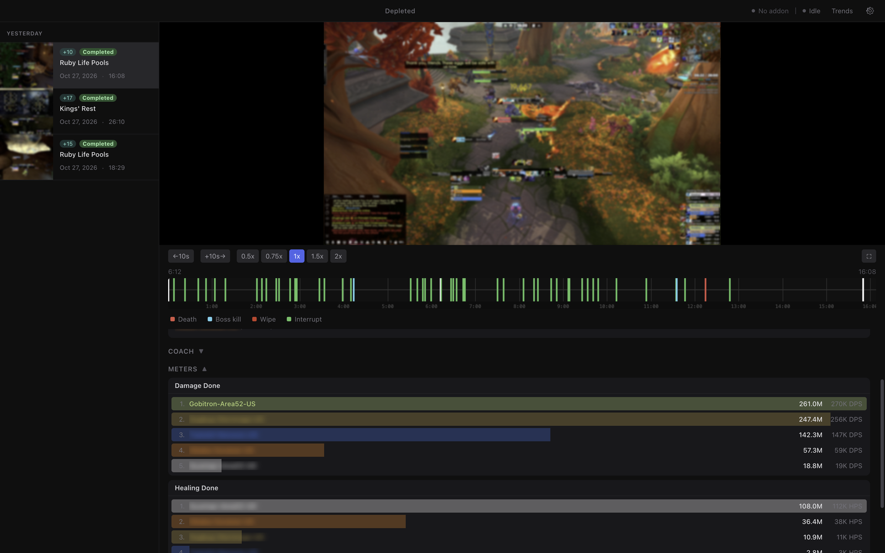
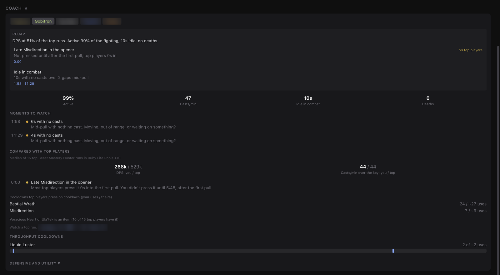
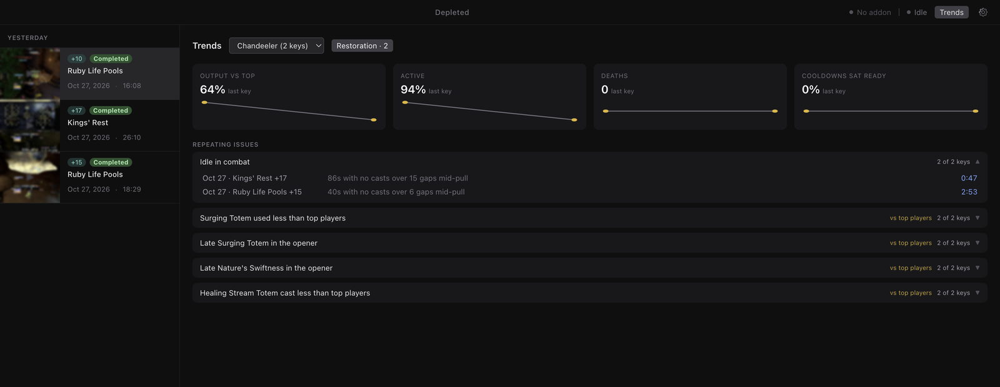

<p align="center">
  
</p>

<h1 align="center">Depleted</h1>

<p align="center">
  <strong>A Mythic+ recorder and coach for macOS.</strong><br>
  Records every key on its own, lines the video up with the combat log, and shows you the moments worth rewatching.
</p>

<p align="center">
  <a href="https://github.com/chandlerbassett/Depleted/actions/workflows/ci.yml"></a>
  
  <a href="LICENSE"></a>
</p>

---

Depleted watches your combat log while you play. When a key starts it is already recording,
and when the key ends it trims the video, files it with the dungeon, level, timer and score,
and drops every boss pull, death and interrupt on a timeline you can click through. Its Coach
then reviews any player in the group against the top logged runs of their spec in the same
dungeon and key level, and every note it makes jumps the video to the moment it is about.

<p align="center">
  
</p>

<table>
  <tr>
    <td></td>
    <td></td>
  </tr>
</table>

## Features

**Recording**

- Native capture with ScreenCaptureKit and the Mac's hardware video encoder, so recording
  costs very little CPU while you play
- HEVC by default (H.264 if you prefer), with quality presets of 30, 50 and 80 Mbps or a
  custom bitrate up to 100 Mbps, and resolutions up to 4K from your display's full Retina pixels
- Colors that match the game: capture is converted and tagged as sRGB / BT.709, so footage
  from a P3 display doesn't play back washed out
- Records the game's audio with no extra audio tools
- A 15 second **pre-roll**: recording arms when you enter the dungeon, so the countdown is in
  the video, and the clip ends about 18 seconds after the key so the completion screen is too
- Keys you leave and don't come back to within 3 minutes are saved as *abandoned* instead of lost

**Review**

- Every run is saved with its dungeon, key level, affixes, outcome (completed, depleted or
  abandoned), timer and score
- A timeline with boss **kills and wipes**, **party deaths** (each with the last 10 seconds of
  damage taken) and **interrupts**
- **DPS and HPS meters** for the party, with pet damage credited to its owner
- Click any party member to open them on **Raider.IO**, **Warcraft Logs** or the Armory
- Deleting a run asks first and moves it to the Trash, so a stray click can be undone

**Coach**

- Reviews any party member, any class and spec: time spent casting, mid-pull gaps with no
  casts, throughput cooldowns that sat ready, and which defensives looked ready when they died
- Compares the key with the **top Warcraft Logs runs** of the same spec, dungeon and key level:
  output, how soon and how often top players press their cooldowns, potions, and core spells
  cast much less. It learns this from the logs, so it works for every spec without hand-written rules
- Gear- and talent-aware: a spell you can't cast with your build isn't flagged as missing
- A **recap** for each key and **Trends** across keys, so you can see what keeps coming up
- Every finding jumps the video to the moment it describes

**Companion addon**

- **DepletedCompanion** tells the app which character you're playing and turns on combat
  logging when you enter a dungeon, so you never lose a key to a forgotten `/combatlog`

## Requirements

- A Mac with **Apple silicon** (M1 or later) running **macOS 13 Ventura** or later. Intel Macs
  aren't supported.
- **Advanced Combat Logging** turned on in the game (see [Setup](#setup))
- **Screen Recording** permission for Depleted
- Optional: a free Warcraft Logs API client, for the Coach's comparison with top players

Nothing else to install. Capture, encoding, trimming and thumbnails all go through macOS's own
frameworks via a small bundled Swift helper.

## Install

1. Download the latest `.dmg` from [Releases](https://github.com/chandlerbassett/Depleted/releases)
   and drag **Depleted** into **Applications**.
2. Open it. Depleted is signed with a Developer ID and notarized by Apple, so macOS only asks
   once whether you want to open an app downloaded from the internet.
3. Allow **Screen Recording** when the onboarding asks (or in
   **System Settings → Privacy & Security → Screen Recording**), then quit and reopen Depleted.

Depleted keeps itself up to date from this repo's releases (from 1.1.0 on). When an update
has downloaded, a **Restart to update** button appears next to the version in the top right;
otherwise it installs the next time you quit.

### Verify your download (optional)

Every release is built by this repository's [release workflow](.github/workflows/release.yml)
from a commit on `main`, signed, notarized, and published with a SHA-256 checksum and a
GitHub build provenance attestation. To check a download:

```bash
# Built by this repo's workflow, from this repo's source
gh attestation verify Depleted-*.dmg -R chandlerbassett/Depleted

# Matches the checksum on the release page
shasum -a 256 Depleted-*.dmg

# The disk image is signed and notarized
spctl --assess --type open --context context:primary-signature --verbose=4 Depleted-*.dmg
xcrun stapler validate Depleted-*.dmg

# The app is signed by the developer and notarized by Apple (after installing)
spctl --assess --verbose=4 /Applications/Depleted.app
```

## Setup

### 1. Turn on Advanced Combat Logging

In game: **Esc → Options → System → Network → Advanced Combat Logging**. You only do this once.
The game writes combat logs to `_retail_/Logs/`, and Depleted follows the newest one automatically.

### 2. Install the companion addon (recommended)

Install it from the onboarding screen or **Settings → WoW Addon**. Or copy `addon/DepletedCompanion`
into `_retail_/Interface/AddOns/` and `/reload` in game. Type `/depleted` in game to check it's loaded.

### 3. Connect Warcraft Logs (optional, for the Coach)

The Coach's comparison with top players uses the Warcraft Logs API with your own free client:

1. Sign in at [warcraftlogs.com/api/clients](https://www.warcraftlogs.com/api/clients) and create
   a client. Any name works; use `http://localhost` as the redirect URL and leave
   **Public Client** unchecked.
2. In Depleted, open **Settings → Warcraft Logs**, paste the client ID and secret, and click **Connect**.

The secret is stored encrypted with your macOS Keychain and is only ever sent to Warcraft Logs.
Without a client, the Coach still reviews each key on its own.

### 4. Play

Open Depleted before you zone into the dungeon. It records, trims and lists the key by itself.
Click a recording to watch it, and click any marker or Coach note to jump to that moment.

When a key ends, everything Depleted needs (the timeline and the Coach's data) is saved next to
the video, so you can delete old combat logs whenever you like. Keep a log only if you want to
upload that key to Warcraft Logs.

## Privacy and security

Your recordings, timelines and Coach data stay on your Mac, in a folder only your user account
can read. Depleted only goes online for two things: checking this repo's releases for updates,
and, if you connect it, the Warcraft Logs API with your own client. Player links open in your
browser.

The app runs with Electron's sandbox and context isolation on, a strict content security
policy, and a short allowlist of permissions. Releases are built only from `main` by a
protected release workflow, notarized by Apple, and checked by macOS's code signature before
an update installs. To report a vulnerability, see [SECURITY.md](SECURITY.md).

## Settings

| Setting | What it does |
|---------|--------------|
| WoW Installation | Your game folder (detected automatically) |
| Recording Storage | Where recordings go (default `~/Movies/Depleted`) |
| Video Quality | 30 / 50 / 80 Mbps presets or Custom up to 100 Mbps; HEVC or H.264; 4K, Native, 1440p, 1080p or 720p; 30 or 60 fps; and which window to capture (found automatically) |
| WoW Addon | Install or update DepletedCompanion |
| Auto-Cleanup | Delete old recordings after N days or once they pass N GB |
| Character Stats | Where player names link to (Raider.IO, Warcraft Logs or the Armory) and your region |
| Warcraft Logs | Your API client for the Coach |
| Test Mode | Record a short test clip to check capture and audio |

A 30 minute key at 30 Mbps is close to 7 GB, so pick a storage folder with room, or turn on auto cleanup.

## Building from source

You need Node.js 22 and the Xcode Command Line Tools (`xcode-select --install`).

```bash
git clone https://github.com/chandlerbassett/Depleted.git
cd Depleted
npm install

# Optional, once per Mac: a local code-signing certificate so Screen Recording
# permission survives rebuilds (see below)
./scripts/create-signing-cert.sh

npm run dev          # run with hot reload
npm run build:mac    # or build dist/Depleted-<version>-arm64.dmg
```

`npm run build:native` builds just the Swift capture helper into `native/bin/`. `build:mac` and
`dev` need it, and `build:mac` builds it for you.

**About signing.** Without a Developer ID, builds are ad-hoc signed and macOS forgets the Screen
Recording grant after every rebuild. `scripts/create-signing-cert.sh` creates a self-signed
certificate called *Depleted Local Signing* in your login keychain, and every later build is
signed with it, so the grant sticks. It only exists on your Mac and doesn't make builds trusted
anywhere else. To sign with another identity, set `DEPLETED_SIGN_IDENTITY`.

### Development

```bash
npm test             # unit tests (vitest)
npm run lint
npm run build        # compile without packaging
```

```
src/
  main/            Electron main process
    combatlog/     log watcher and parser
    recorder/      Mythic+ state machine and the native capture bridge
    coach/         key review and Warcraft Logs benchmarks
    storage/       trimming, thumbnails, metadata, recordings library
  renderer/src/    Vue 3 + Pinia UI
  shared/          types and constants shared by both
native/
  DepletedCapture/ Swift helper: ScreenCaptureKit capture, hardware encode, trim, thumbnail
addon/
  DepletedCompanion/  the in-game companion addon (Lua)
tests/             vitest suites and a sample Mythic+ combat log
```

See [CONTRIBUTING.md](CONTRIBUTING.md) before opening a pull request.

## Known limitations

- **A key finished over time may still say completed.** The combat log's success flag doesn't
  say whether the timer was beaten.
- **The Coach's top-player comparison uses Warcraft Logs API points.** Benchmarks are cached
  on disk for three days, so each dungeon, spec and level is only fetched once in that time.

If something goes wrong, Depleted's log is at `~/Library/Logs/Depleted/main.log`. Attaching it
to a [bug report](https://github.com/chandlerbassett/Depleted/issues/new/choose) helps a lot.

## Credits

Depleted started as a fork of [**wowArenaAnalyzer**](https://github.com/krav559108/wowArenaAnalyzer)
by Aleksandr Kravchenko (MIT), which provided the original Electron app, combat log watcher and
parser, and playback UI. Thank you! Its arena features have since been replaced with Mythic+
recording, native capture and the Coach. If you play arena, the original project is the one for you.

Top-player data comes from [Warcraft Logs](https://www.warcraftlogs.com/). Player links go to
[Raider.IO](https://raider.io/) and [Warcraft Logs](https://www.warcraftlogs.com/).

## License

[MIT](LICENSE). Copyright © 2024 Aleksandr Kravchenko and © 2026 Chandler Bassett.

## Disclaimer

Depleted is an independent fan project. It is not affiliated with, endorsed by or sponsored by
Blizzard Entertainment. World of Warcraft and Warcraft are trademarks or registered trademarks of
Blizzard Entertainment, Inc. in the U.S. and/or other countries. Depleted only reads the combat log
the game writes and records your screen. It doesn't read or modify game memory or automate gameplay.
